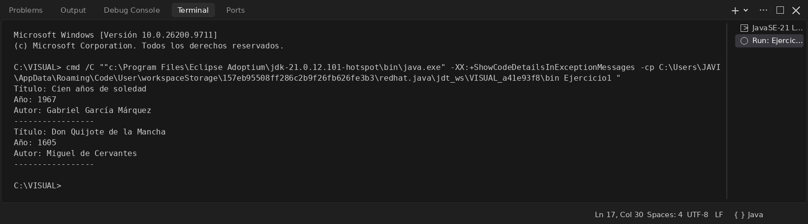
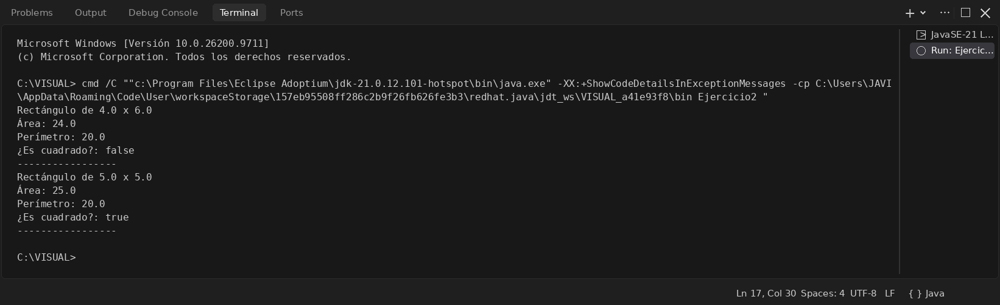
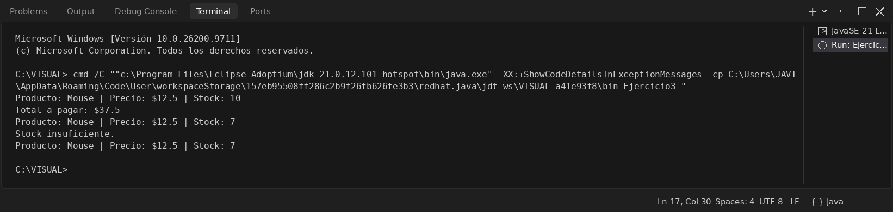
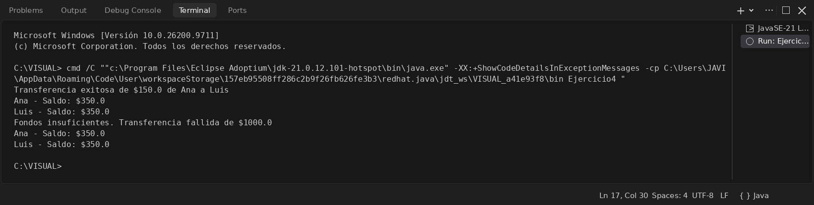
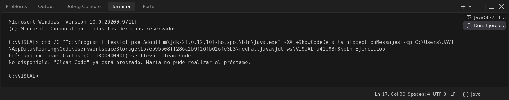

<p align="center">
  
</p>


## Estructura del repositorio

```
5-EJERCICIOS-APE/
├── Ejercicio1.java
├── Ejercicio1.png
├── Ejercicio2.java
├── Ejercicio2.png
├── Ejercicio3.java
├── Ejercicio3.png
├── Ejercicio4.java
├── Ejercicio4.png
├── Ejercicio5.java
├── Ejercicio5.png
├── banner.svg
└── README.md
```

## Resumen de los ejercicios

| N.º | Archivo | Tema | Clases |
|---|---|---|---|
| 1 | `Ejercicio1.java` | Relación entre objetos: un libro tiene un autor | `Autor`, `Libro` |
| 2 | `Ejercicio2.java` | Métodos con valores de retorno | `Rectangulo` |
| 3 | `Ejercicio3.java` | Control de inventario y ventas | `Producto`, `Venta` |
| 4 | `Ejercicio4.java` | Operaciones bancarias y transferencias | `Cuenta` |
| 5 | `Ejercicio5.java` | Sistema de préstamo de libros | `Usuario`, `Libro`, `Prestamo` |

## Detalle de cada ejercicio

### Ejercicio 1: Libros y autores
Define la clase `Autor` (nombre y nacionalidad) y la clase `Libro` (título, año y un objeto `Autor`). El método `mostrarInformacion()` imprime los datos del libro junto con el nombre de su autor. Se crean dos libros, *Cien años de soledad* y *Don Quijote de la Mancha*.



### Ejercicio 2: Rectángulo
La clase `Rectangulo` guarda la base y la altura, y ofrece métodos para calcular el **área**, el **perímetro**, saber si es un **cuadrado** y obtener una **descripción** en texto. El método `mostrar()` imprime todos los resultados para un rectángulo de 4 x 6 y otro de 5 x 5.



### Ejercicio 3: Productos y ventas
La clase `Producto` maneja nombre, precio y stock, con el método `reducirStock()` que valida que haya unidades suficientes. La clase `Venta` aplica una cantidad vendida a un producto y calcula el total a pagar. El ejemplo registra una venta válida de 3 unidades y una fallida de 8, que muestra el mensaje de stock insuficiente.



### Ejercicio 4: Cuentas bancarias
La clase `Cuenta` tiene titular y saldo, con los métodos `depositar()`, `retirar()` y `transferir()`. La transferencia retira el monto de una cuenta y lo deposita en otra solo si hay fondos suficientes. El ejemplo hace una transferencia válida de $150 y otra fallida de $1000 entre Ana y Luis.



### Ejercicio 5: Préstamo de libros
Combina tres clases: `Usuario` (nombre y cédula), `Libro` (título y disponibilidad, con `prestar()` y `devolver()`) y `Prestamo`, que relaciona a un usuario con un libro. Cuando dos usuarios piden el mismo libro, el primer préstamo es exitoso y el segundo se rechaza porque el libro ya está prestado.



## Conceptos aplicados

- Clases, objetos y constructores
- Atributos y métodos, con uso de `this`
- Métodos con retorno (`double`, `boolean`, `String`) y métodos `void`
- Relaciones entre clases: un objeto contiene o recibe a otro
- Validaciones con condicionales (`if / else`)
- Salida por consola con `System.out.println`


>
